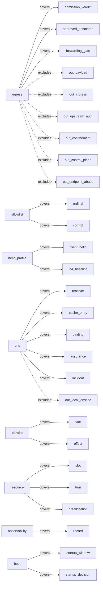
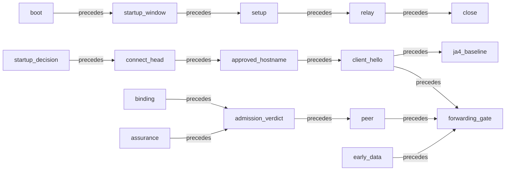
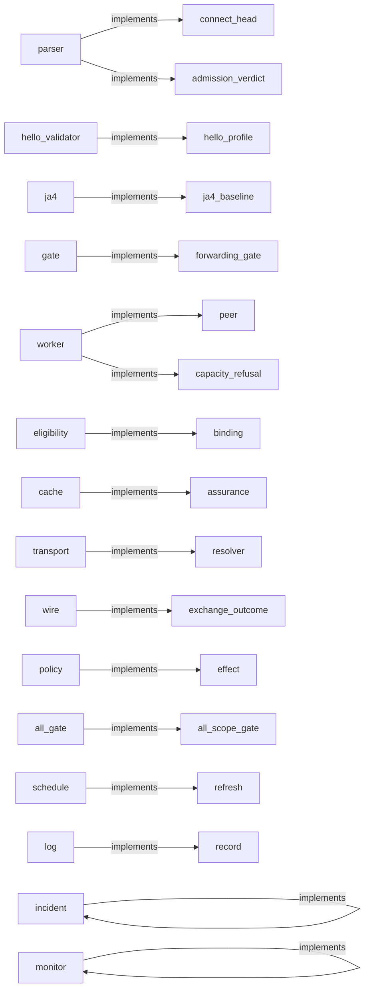
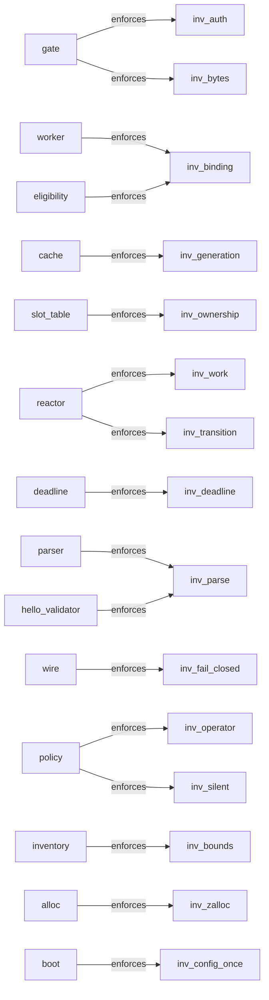
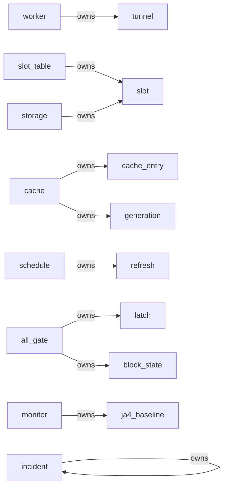
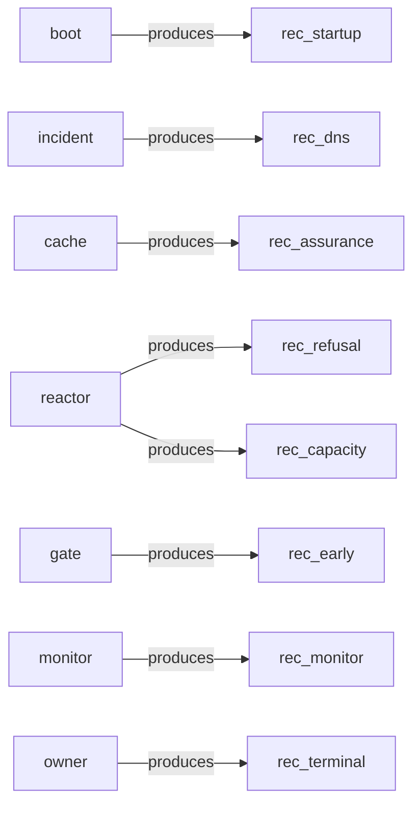
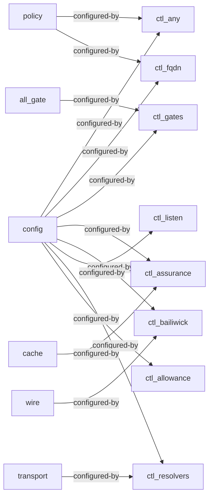
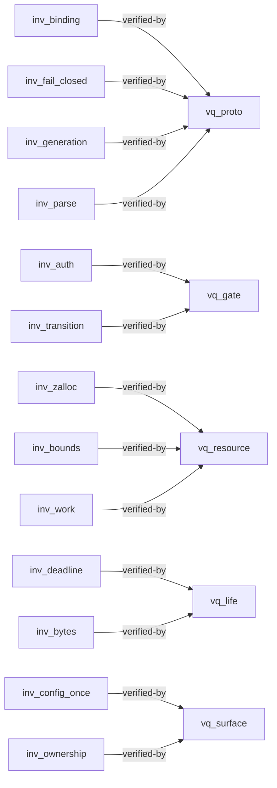

# Alumina ontology

Non-normative vocabulary map; [`alumina-proxy.md`](alumina-proxy.md) governs.

## Scope

| ID | Definition | Code |
|---|---|---|
| `egress` | Police CONNECT egress from a trusted-at-rest workload | — |
| `allowlist` | Operator's `name:port` set is the only admission authority | `Config`, `Allowlist` |
| `hello-profile` | Acceptance checks on the initial ClientHello; never negotiation | `validate`, `HelloRejectReason` |
| `dns` | Name→address truth with bounded staleness and declared assurance | `Cache`, `Schedules` |
| `tripwire` | Enumerated surfaces whose deviation becomes a typed fact | `Violation` |
| `resource` | Fixed capacities, one boot owner, one serving owner, no post-boot allocation | `ServeStorage`, `inventory` |
| `observability` | Stdout records only: bounded, lossy, counted | `log` |
| `boot` | Preflight, config-once, storage construction, bounded startup window | `run_boot` |
| `out-payload` | No decryption, keys, CA role, or payload inspection | — |
| `out-ingress` | Not an ingress guard, WAF, reverse proxy, or gateway | — |
| `out-upstream-auth` | Client owns upstream certificate/hostname verification | — |
| `out-confinement` | Deployment denies alternate egress paths | — |
| `out-local-dnssec` | No local DNSSEC, DO, or recursion; delegated assertion only | — |
| `out-control-plane` | No readiness, metrics, admin, debug, or reload surface | — |
| `out-endpoint-abuse` | Abuse inside an admitted endpoint's own capability is unreachable | — |

## Admission

| ID | Definition | Code |
|---|---|---|
| `connect-head` | Untrusted request head; incremental, read-boundary independent | `ConnectParser`, `ConnectRequest`, `ConnectError`, `ConnectHeadReason` |
| `admission-verdict` | Terminal pre-dial decision: admit with peer, or refuse with a class | `ConnectPhase` |
| `approved-hostname` | Host after allowlist match; identity SNI must reproduce | `FixedHostname` |
| `ordinal` | Sorted position of an entry; the only per-domain key | `DomainOrdinal` |
| `client-hello` | Initial TLS message; untrusted, framed, capped | `ClientHello`, `ChInspector` |
| `ja4-baseline` | First distinct fingerprint per ordinal; later ones are changes | `FactCounters::ja4_value` |
| `forwarding-gate` | Two-barrier byte permission; opens after validated hello + peer | `TunnelGate`, `GatePhase`, `ValidatedHello` |
| `early-data` | Upstream activity seen through I/O before the gate opens | `Activity`, `TerminateReason`, `observe_upstream_activity` |
| `peer` | Committed upstream endpoint; fixed for the tunnel's life | `PeerDecision`, `Deadline` |
| `refusal` | Wire status + reason ending an attempt | `Refusal`, `RefusalWire`, `RejectReason` |
| `capacity-refusal` | Slots or pending setups exhausted | `AdmissionError` |

## Resolution

| ID | Definition | Code |
|---|---|---|
| `resolver` | Bare IP (TCP) or `IP#fqdn` with optional pin (DoT) | `ResolverSet`, `Nameserver` |
| `dns-wire` | Untrusted response bytes, validated in staging | `ResponseWorkspace`, `BailiwickZones`, `DnsError` |
| `exchange-outcome` | Positive / NXDOMAIN / NODATA / exchange failure | `wire::Outcome` |
| `cache-entry` | Per name × family: bindings, deadlines, generation, proof | `Entry` |
| `binding` | One eligible address in an entry, sharing its deadlines | `EligibleBindings`, `BindingList`, `StagedPositive` |
| `binding-state` | Fresh / stale-serving / retired; derived, never stored | `EntryState` |
| `generation` | Isolation token rejecting stale results and events | `Generation`, `Generations` |
| `assurance` | Declared proof requirement, satisfied by a current proof class | `grade_key`, `AssuranceSnapshot`, `AssuranceObservation` |
| `incident` | Unresolved duration per name × family, not one failure | `incident_report`, `NameOutcome`, `FailureReason` |
| `refresh` | Due times, negative scheduling, capped backoff | `schedule` |

## Enforcement

| ID | Definition | Code |
|---|---|---|
| `fact` | AnyIllegal, EarlyUpstreamData, Ja4Change, or Unknown | `Violation`, `AnyIllegalCause`, `UnknownReason` |
| `control` | One configured key with exactly one `{action, scope}` | `Control`, `PerFqdnControl`, `AnyIllegalControl`, `ControlTable`, `Scope`, `ActionKind` |
| `effect` | BaselineOnly \| Notify \| Block \| Unknown | `Effect`, `decide` |
| `latch` | Lets exactly one unattributable violation select an action | `FirstSlot` |
| `all-scope-gate` | Per-class threshold/window; sticky once armed | `AllScopeGate`, `GateSet`, `WindowedCounter` |
| `block-state` | Connection / ordinal / all; ordinal and all sticky | `Enforcement` |
| `monitor` | Counters + bounded capture + reserved summary | `Monitor`, `FactCounters`, `ActionCounters`, `RefusalCounters` |

## Ownership

| ID | Definition | Code |
|---|---|---|
| `slot` | Preallocated connection workspace; outlives many tunnels | `SlotIndex`, `TrafficBuffer` |
| `tunnel` | Relay between admitted client and committed peer | `Worker`, `Worker::admit` |
| `turn` | Bounded work before timers and other slots are rechecked | `VISIT_OPS`, `VISIT_BYTES`, `TIMER_RECHECK_EVERY` |
| `deadline` | Monotonic instant that progress cannot renew | `Deadline` |
| `preallocation` | All storage exists before serving | `ServeStorage::boot` |
| `zero-allocation` | First-party allocation only at boot | `alloc` |

## Observations

| ID | Definition | Code |
|---|---|---|
| `record` | One bounded stdout line; emitted whole or dropped whole | `log::Kind` |
| `record-class` | Reserved (verdict) vs normal (detail) | queue priority |
| `drop-accounting` | Loss counted, never silent | `log` |
| `rec-startup` | `startup_warning`, `startup_name`, `startup_final`, `resolver_probe`, `dns_assurance` | `log` |
| `rec-dns` | `exchange_failed`, `incident_open`, `incident_recovered`, `incident_summary`, `incident_eligible_loss`, `incident_eligible_recovered` | `log` |
| `rec-assurance` | `dns_assurance`, `dns_assurance_fault` | `log` |
| `rec-refusal` | `reject` + wire refusals 400/403/502/503/504 | `Refusal` |
| `rec-early` | `early_activity` | `log` |
| `rec-capacity` | `capacity_high/low`, `queue_high/low` | `log` |
| `rec-monitor` | `monitor`, `monitor_domain`, `monitor_capture` | `Monitor` |
| `rec-terminal` | `fatal`, `shutdown_final`; exit 0/70/74/75/78 | `log` |

## Boot and operator surface

| ID | Definition | Code |
|---|---|---|
| `startup-window` | Bounded resolution before the listener exists | `run_startup`, `StartupOutcome` |
| `startup-decision` | Serve (full/degraded), exit 75, or terminated | `StartupDecision`, `ServingMode` |
| `serving-loop` | Single owner loop over sockets, DNS, timers, logs | `Serving`, `Stage` |
| `shutdown` | SIGTERM stops accepting, drains bounded, exits | `Shutdown`, `ShutdownExit` |
| `ctl-any` | Four unattributable keys; action notify/block, scope connection/all | `AnyIllegalControl` |
| `ctl-fqdn` | `early_data`, `ja4`; action notify/block/ignore, scope connection/fqdn/all | `PerFqdnControl` |
| `ctl-gates` | Optional `[bad_handshake]`, `[illegal_fqdn]`, `[ja4]`: threshold, window | `GateSet` |
| `ctl-assurance` | Mandatory per-entry `dns_assurance` | `Config` |
| `ctl-bailiwick` | Optional per-entry `cname_bailiwick` suffix union | `BailiwickZones` |
| `ctl-listen` | Single listener address | `ListenAddr` |
| `ctl-resolvers` | Resolver array + `recursive_dnssec_policy` | `ResolverSet` |
| `ctl-allowance` | `startup_unresolved_allowance` | `Config` |
| `ctl-fixed` | Never configurable: vocabulary, semantics, limits, deadlines, ports, tarpit | — |

## Invariants

| ID | Prevents | Code |
|---|---|---|
| `inv-binding` | "authorise once, dial later against new DNS" | `Worker` |
| `inv-auth` | "forward first, validate second" | `TunnelGate` |
| `inv-fail-closed` | "be permissive on ambiguity" | `publication` |
| `inv-zalloc` | "memory/latency grow with load" | `alloc` |
| `inv-bounds` | "exhaustion becomes growth" | `inventory` |
| `inv-ownership` | "two writers, one connection" | slot table |
| `inv-generation` | "slow answer writes into a reused slot" | `Generations` |
| `inv-work` | "one busy connection starves a deadline" | reactor budget |
| `inv-transition` | "readiness treated as success" | `Stage` |
| `inv-parse` | "decision depends on TCP split" | `ConnectParser`, `ChInspector` |
| `inv-nodecrypt` | "the proxy becomes a CA, hence a target" | — |
| `inv-bytes` | "silently skip a chunk and continue" | gate accounting |
| `inv-deadline` | "progress renews an expired phase" | `Deadline` |
| `inv-scope` | "one more feature turns a gate into a gateway" | — |
| `inv-silent` | "a tolerated rate of bad behaviour" | `decide` |
| `inv-operator` | "operator redefines what block means" | `decide` |
| `inv-config-once` | "runtime policy mutation as attack path" | `run_boot` |
| `inv-fail-stop` | "limping on in an unreasoned state" | lints |

## Verification

`vq-proto`, `vq-gate`, `vq-life`, `vq-dnsclass`, `vq-dnsobs`, `vq-resource`, `vq-log`, `vq-startup`, `vq-confinement`, `vq-surface`, `vq-perf` — one per bullet in [Verification requirements](alumina-proxy.md#verification-requirements). `inv-nodecrypt`, `inv-fail-stop`, `inv-operator` have no obligation.

## Relations

The diagrams below are the relation set. Node IDs encode `-` as `_`; edge labels are the predicates `covers`, `excludes`, `implements`, `enforces`, `owns`, `produces`, `configured-by`, `verified-by`, `precedes`.

### Scope and refusals

### Ordering

### Realisation

### Enforcement

### Ownership

### Observations

### Operator surface

### Proof

## Naming debt

Derived by mapping every term above to the code symbol that realises it, then flagging symbols whose noun differs from the term's noun. Churn is `rg` counts over `src` and `tests` at authoring time (files / references): it ranks the proposals and warns about cost, it does not gate them.

A name is flagged when it describes storage or layout instead of meaning (`Fixed`, `Slot`, `Entry`, `Serving`), describes progress where the type is terminal (`ConnectPhase`), abbreviates a word nobody says (`Ch`), generalises past its own range (`AdmissionError` means capacity only), or spends one word on two concepts (`gate`, `serving`, `Outcome`). Names that already speak the language are left alone. Proposals are not applied changes: the target term is settled here first, then each rename ships as its own increment, with an alias across the widest-churn case.

| ID | Current | Proposed | Why | Churn |
|---|---|---|---|---|
| `latch` | `FirstSlot` | `FirstIllegalLatch` | "slot" is a tunnel-slot noun | 96 refs / 8 files |
| `admission-verdict` | `ConnectPhase` | `AdmissionVerdict` | terminal incl. `Peer`; "phase" implies progress | 79 / 6 |
| `capacity-refusal` | `AdmissionError` | `CapacityRefusal` | only slot/pending exhaustion | 2 variants |
| `forwarding-gate` | `TunnelGate` | `ForwardingGate` | spec term; collides with `AllScopeGate` | 26 / 2 |
| `approved-hostname` | `FixedHostname` | `ApprovedHostname` | "fixed" is storage; identity is approval | 132 / 13 |
| `binding-state` | `EntryState::Stale` | `StaleServing` | stale ≠ expired | small |
| `client-hello` | `ChInspector`, `ChError` | `ClientHelloInspector`, `ClientHelloError` | "Ch" is not a domain word | 43+143 / 8,4 |
| `connect-head`, `client-hello` | `Feed`, `Inspect` | `ConnectParseStep`, `HelloParseStep` | one vague name, two modules | small |
| `serving-loop` | `Serving` | `ServingLoop` | "serving" also means mode and storage | 1 file |
| `serving-loop` | `Stage` | `SlotStage` | distinct from `GatePhase` | private |
| `cache-entry` | `Entry` | `CacheEntry` | generic name for the DNS component | 3 / 2 |
| `exchange-outcome` | `wire::Outcome` | `ExchangeOutcome` | collides with `NameOutcome` | small |
| `block-state` | `Enforcement` | `EnforcementState` | context noun used as state object | small |

Already aligned: `DomainOrdinal`, `Violation`, `Effect`, `decide`, `AllScopeGate`, `WindowedCounter`, `EntryState`, `BailiwickZones`, `AttemptLedger`.
